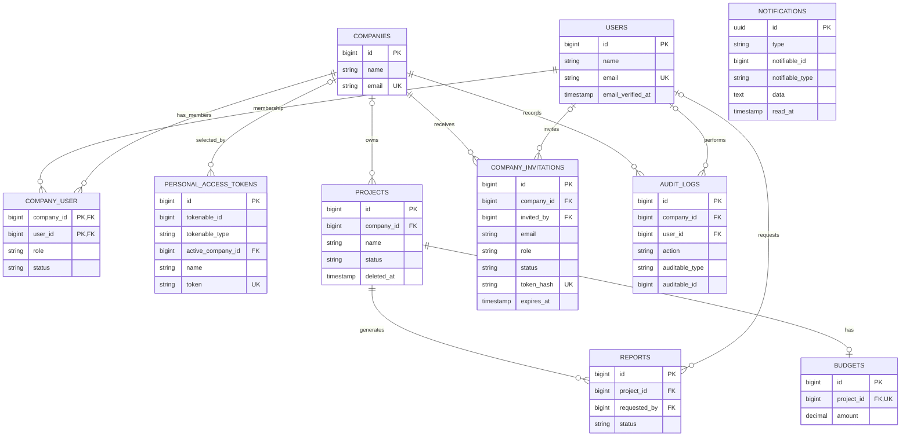

# Construction Backend

**A multi-tenant RESTful API for construction company management, built with Laravel.**

Construction Backend is a RESTful API designed to manage construction companies, projects, budgets, team members, and project reports.

The application supports multiple companies per user, company-specific access control, role-based permissions, and token-based authentication using Laravel Sanctum.

## Features

- **Authentication:** User registration, login, logout, password changes, and email verification.
- **Multi-company support:** Users can belong to multiple companies.
- **Active company context:** Each API token can select its active company.
- **Role-based access control:** Owner, admin, and employee roles.
- **Company invitations:** Invite users by email, accept or reject invitations, and manage membership.
- **Member management:** List members, change roles, deactivate memberships, and remove members.
- **Project management:** Create, list, update, soft-delete, restore, and permanently delete projects.
- **Budget management:** Create and manage project budgets, including company-specific access control.
- **Project reports:** Request asynchronous report generation using queued jobs.
- **Notifications:** Retrieve notifications and manage their read status.
- **Audit logging:** Record relevant application activities.

## Architecture

The application follows a layered organization using Laravel conventions and dedicated classes for business logic.

- **Actions:** Encapsulate specific business operations.
- **Services:** Handle reusable application logic.
- **DTOs:** Transfer validated data between application layers.
- **Resources:** Standardize API responses.
- **Policies:** Centralize authorization rules.
- **Middleware:** Validate authentication, email verification, and active company membership.
- **Jobs and Events:** Handle asynchronous operations and application events.

### Multi-tenant authorization

Company membership is implemented through a many-to-many relationship using the `company_user` pivot table.

Each Sanctum API token stores an `active_company_id`, allowing a user to select the company context for that token.

The `active.company` middleware validates:

1. Whether the token has an active company selected.
2. Whether the authenticated user belongs to that company.
3. Whether the membership is active.

Policies enforce permissions according to the user's company role.

### Database Entity Relationship Diagram

The following diagram illustrates the main database entities and their relationships, including the multi-tenant company structure.



## Technology Stack

- PHP 8.5
- Laravel 13
- Laravel Sanctum
- MySQL 8.4
- Redis 7
- Docker and Docker Compose
- Nginx
- PHPUnit 12

---

# Construction Backend (Español)

**Una API REST multiempresa para la gestión de empresas constructoras, desarrollada con Laravel.**

Construction Backend es una API REST diseñada para gestionar empresas constructoras, proyectos, presupuestos, integrantes y reportes de proyectos.

La aplicación permite que un usuario pertenezca a múltiples empresas, con control de acceso independiente por empresa, permisos basados en roles y autenticación mediante tokens con Laravel Sanctum.

## Funcionalidades

- **Autenticación:** Registro, inicio y cierre de sesión, cambio de contraseña y verificación de correo.
- **Soporte multiempresa:** Un usuario puede pertenecer a varias empresas.
- **Contexto de empresa activa:** Cada token de API puede seleccionar su empresa activa.
- **Control de acceso por roles:** Owner, admin y employee.
- **Invitaciones:** Invitar usuarios por correo electrónico, aceptar o rechazar invitaciones y gestionar membresías.
- **Gestión de integrantes:** Listar integrantes, cambiar roles, desactivar membresías y eliminar integrantes.
- **Gestión de proyectos:** Crear, listar, actualizar, eliminar lógicamente, restaurar y eliminar permanentemente proyectos.
- **Gestión de presupuestos:** Crear y administrar presupuestos asociados a proyectos.
- **Reportes:** Solicitar la generación asíncrona de reportes mediante trabajos en segundo plano.
- **Notificaciones:** Consultar notificaciones y administrar su estado de lectura.
- **Registro de auditoría:** Registrar actividades relevantes de la aplicación.

## Arquitectura

La aplicación utiliza una organización por capas basada en las convenciones de Laravel y clases específicas para la lógica de negocio.

- **Actions:** Encapsulan operaciones específicas del negocio.
- **Services:** Gestionan lógica reutilizable.
- **DTOs:** Transportan datos validados entre capas.
- **Resources:** Estandarizan las respuestas de la API.
- **Policies:** Centralizan las reglas de autorización.
- **Middleware:** Valida autenticación, verificación de correo y membresía en la empresa activa.
- **Jobs y Events:** Gestionan operaciones asíncronas y eventos de la aplicación.

### Autorización multiempresa

La relación entre usuarios y empresas se implementa mediante una relación muchos a muchos utilizando la tabla intermedia `company_user`.

Cada token de API de Sanctum almacena un `active_company_id`, que permite seleccionar el contexto de empresa de ese token.

El middleware `active.company` valida:

1. Que el token tenga una empresa activa seleccionada.
2. Que el usuario autenticado pertenezca a esa empresa.
3. Que su membresía se encuentre activa.

Las Policies aplican los permisos correspondientes según el rol del usuario en cada empresa.

---
### Colección de Postman

El repositorio incluye una colección de Postman para probar la API sin necesidad de desarrollar un frontend.

#### Importar la colección y el entorno

1. Abrir Postman.
2. Seleccionar **Import**.
3. Importar los dos archivos de `docs/postman/`:
   - `Construction Backend API.postman_collection.json`
   - `Construction Backend - Local.postman_environment.json`
4. Seleccionar el entorno **Construction Backend - Local**.

#### Configurar el entorno

Editar la variable `base_url` y reemplazar `YOUR_VM_IP` por la dirección IP de la máquina donde se ejecuta Docker.

Por ejemplo:

- Docker en la misma máquina que Postman: `http://localhost:8080/api`.
- Docker en una máquina virtual: `http://IP_DE_TU_VM:8080/api`.

El entorno contiene las siguientes variables:

| Variable | Descripción |
|---|---|
| `base_url` | URL base de la API |
| `token` | Token de autenticación de Laravel Sanctum |
| `company_id` | ID de la empresa seleccionada |
| `project_id` | ID de un proyecto |
| `report_id` | ID de un reporte generado |

#### Autenticación y pruebas

1. Registrar un usuario mediante `POST /register` o utilizar una cuenta existente.
2. Verificar el correo electrónico mediante el enlace guardado en los logs de Laravel.
3. Iniciar sesión mediante `POST /login`.
4. Configurar la variable `token` con el token Sanctum devuelto, si no se completa automáticamente.
5. Consultar `GET /my-companies` para obtener las empresas del usuario.
6. Configurar `company_id` y seleccionar la empresa mediante `POST /companies/{company}/select`.
7. Utilizar la carpeta Projects para crear o consultar un proyecto y configurar `project_id`.
8. Utilizar la carpeta Reports para solicitar un reporte y configurar `report_id` con el ID devuelto.

Las solicitudes protegidas heredan la autenticación Bearer Token configurada en la colección mediante `{{token}}`.

**Importante:** El entorno publicado es una plantilla sin credenciales ni tokens personales. Cada usuario debe configurar su propia URL y token de autenticación.

## Requirements

- Docker Engine
- Docker Compose
- Git

## Getting Started

### 1. Clone the repository

```bash
git clone https://github.com/T0-Bo/construction_backend.git
cd construction_backend
```

### 2. Configure environment variables

```bash
cp .env.example .env
```

Review the `.env` file and adjust the application settings if necessary.

The default configuration is prepared for Docker Compose. Database and Redis hostnames use their respective service names.

### 3. Build the Docker images

```bash
docker compose build
```

### 4. Install PHP dependencies

```bash
docker compose run --rm app composer install
```

### 5. Generate the application key

```bash
docker compose run --rm app php artisan key:generate
```

### 6. Start the containers

```bash
docker compose up -d
```

Docker Compose starts the following services:

- Laravel application (PHP-FPM)
- Nginx
- MySQL
- Redis
- Queue worker

### 7. Run database migrations

```bash
docker compose exec app php artisan migrate
```

### 8. Access the API

The API will be available at:

```text
http://localhost:8080/api
```

The Nginx container exposes port `8080` on the host.

## Environment Configuration

Important environment variables:

| Variable | Description |
|---|---|
| `APP_ENV` | Application environment |
| `APP_DEBUG` | Enables or disables debug mode |
| `APP_URL` | Application base URL |
| `DB_HOST` | MySQL service hostname |
| `DB_DATABASE` | Database name |
| `DB_USERNAME` | Database username |
| `QUEUE_CONNECTION` | Queue driver |
| `REDIS_HOST` | Redis service hostname |
| `MAIL_MAILER` | Mail delivery driver |

The default mail configuration uses `MAIL_MAILER=log`. Emails are written to the Laravel log file instead of being delivered to a real mailbox.

For production deployments, configure appropriate credentials, disable debug mode, and use a real mail provider.

---
## Postman Collection

The repository includes a Postman collection to test the API without implementing a frontend.

### Import the collection and environment

1. Open Postman.
2. Click **Import**.
3. Import both files from `docs/postman/`:
   - `Construction Backend API.postman_collection.json`
   - `Construction Backend - Local.postman_environment.json`
4. Select the imported environment, **Construction Backend - Local**.

### Configure the environment

Edit the `base_url` variable and replace `YOUR_VM_IP` with the IP address of the machine running Docker.

For example:

- Docker running on the same machine as Postman: `http://localhost:8080/api`.
- Docker running inside a virtual machine: `http://YOUR_VM_IP:8080/api`.

The environment includes the following variables:

| Variable | Description |
|---|---|
| `base_url` | API base URL |
| `token` | Laravel Sanctum authentication token |
| `company_id` | Selected company ID |
| `project_id` | Project ID |
| `report_id` | Generated report ID |

### Authentication and testing

1. Register a user using `POST /register`, or use an existing account.
2. Verify the email address using the verification link written to the Laravel log.
3. Log in using `POST /login`.
4. Set the returned Sanctum token in the `token` environment variable if it is not populated automatically.
5. Use `GET /my-companies` to retrieve the user's companies.
6. Set `company_id` and select a company using `POST /companies/{company}/select`.
7. Use the Projects folder to create or retrieve a project and set `project_id`.
8. Use the Reports folder to request a report and set `report_id` to the returned report ID.

Protected requests inherit Bearer Token authentication from the collection using `{{token}}`.

**Important:** The exported environment is a template and does not contain authentication credentials or personal tokens. Each user must configure their own API URL and authentication token.


## API Endpoints

All endpoints use the `/api` prefix.

### Authentication

| Method | Endpoint | Description | Access |
|---|---|---|---|
| POST | `/register` | Register a new user | Public |
| POST | `/login` | Authenticate and create an API token | Public |
| POST | `/logout` | Revoke the current token | Authenticated |
| POST | `/logout-all` | Revoke all user tokens | Authenticated |
| POST | `/change-password` | Change account password | Authenticated |
| GET | `/me` | Retrieve authenticated user | Verified |
| GET | `/email/verify/{id}/{hash}` | Verify email address | Signed URL |

### Companies

| Method | Endpoint | Description | Access |
|---|---|---|---|
| GET | `/my-companies` | List user's companies and memberships | Verified |
| POST | `/companies` | Create a company | Verified |
| GET | `/companies/{company}` | Retrieve company details | Verified |
| POST | `/companies/{company}/select` | Select the active company for the current token | Verified |

### Company Invitations and Members

| Method | Endpoint | Description | Access |
|---|---|---|---|
| GET | `/company-invitations` | List active company's invitations | Active company |
| POST | `/company-invitations` | Send a company invitation | Active company |
| POST | `/company-invitations/accept` | Accept an invitation | Verified |
| POST | `/company-invitations/reject` | Reject an invitation | Verified |
| GET | `/company-members` | List company members | Active company |
| PATCH | `/company-members/{member}/role` | Update a member's role | Active company |
| PATCH | `/company-members/{member}/status` | Activate or deactivate a membership | Active company |
| DELETE | `/company-members/{member}` | Remove a company member | Active company |

### Projects

| Method | Endpoint | Description | Access |
|---|---|---|---|
| GET | `/projects` | List company projects | Active company |
| GET | `/projects/{project}` | Retrieve project details | Active company |
| POST | `/projects` | Create a project | Active company |
| PATCH | `/projects/{project}` | Update a project | Active company |
| DELETE | `/projects/{project}` | Soft-delete a project | Active company |
| PATCH | `/projects/{project}/restore` | Restore a soft-deleted project | Active company |
| DELETE | `/projects/{project}/force` | Permanently delete a project | Active company |
| POST | `/projects/{project}/report` | Request asynchronous report generation | Active company |

### Budgets

| Method | Endpoint | Description | Access |
|---|---|---|---|
| GET | `/budgets` | List company budgets | Active company |
| GET | `/budgets/summary` | Retrieve budget summary | Active company |
| GET | `/budgets/{budget}` | Retrieve budget details | Active company |
| POST | `/projects/{project}/budget` | Create a project budget | Active company |

### Reports

| Method | Endpoint | Description | Access |
|---|---|---|---|
| GET | `/reports/{report}` | Retrieve report details and status | Active company |

### Notifications

| Method | Endpoint | Description | Access |
|---|---|---|---|
| GET | `/notifications` | List notifications | Verified |
| GET | `/notifications/unread` | List unread notifications | Verified |
| POST | `/notifications/read-all` | Mark all notifications as read | Verified |
| POST | `/notifications/{notification}/read` | Mark a notification as read | Verified |

### Access Control

- **Public:** No authentication required.
- **Authenticated:** Requires a valid Laravel Sanctum token.
- **Verified:** Requires authentication and a verified email address.
- **Active company:** Requires authentication, a verified email address, a selected active company, and an active membership.

Authorization policies enforce additional role-based permissions for company resources.

---

## Testing

The project includes automated tests for authentication, authorization, company membership, projects, budgets, and other application features.

Run the test suite with:

```bash
docker compose exec app composer test
```

Tests use an in-memory SQLite database, keeping the Docker MySQL development database separate from the test environment.

## Development Notes

- Email delivery uses Laravel's log mail driver by default. Messages are stored in `storage/logs/laravel.log`.
- Background report generation is handled by a database-backed queue worker.
- Redis is used for application caching.
- The default environment configuration is intended for local development, not production deployment.

---

## License

This project is licensed under the MIT License. See the [LICENSE](LICENSE) file for details.
